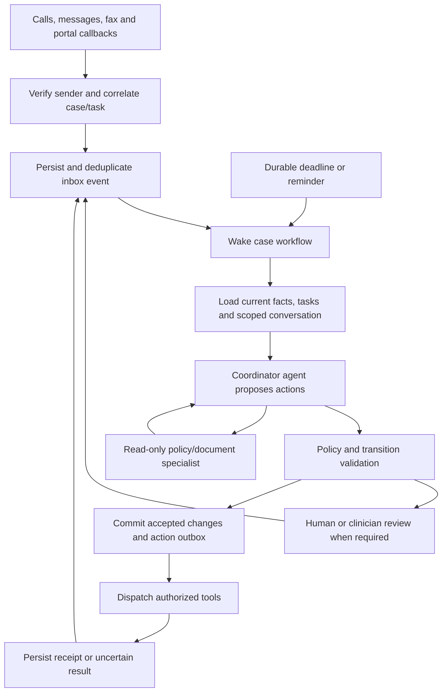
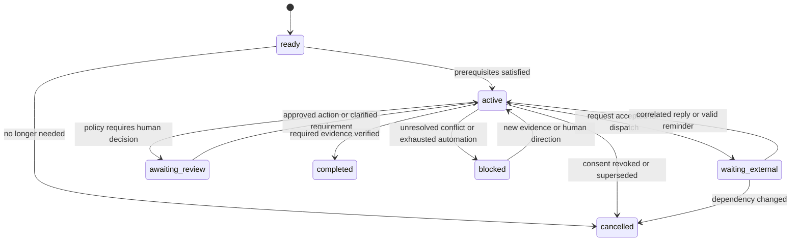

# Decision proposal: an agent-led case coordinator

Status: proposed, not implemented. Evaluated 18 November 2026 against the current Mira prototype. The six original follow-ups were reviewed and committed first; see `FOLLOWUP_REVIEW.md`.

## Recommendation

Use **one case coordinator agent, persisted follow-up tasks, specialized tools, and a durable event-driven execution layer**. Start with a communication/scheduling capability and a read-only Medicare policy/document capability. Add separate specialist agents only when measured tool-selection accuracy, context size, or independent ownership warrants them.

Keep Temporal for the existing project's case lifetime, wakeups, timers, retries, and human decisions. Replace the fixed business sequence with an agent that proposes the next administrative action from current facts and open obligations. Keep policy checks, authoritative state transitions, and side-effect execution outside the model.

The key distinction is between deciding what to do and remembering to do it. The agent chooses the next coordination action. The runtime makes waiting and recovery reliable. Removing durability would work against the requirement to resume a conversation a day later. Temporal explicitly supports long-running agent loops and multi-day waits, and its entity workflow pattern fits a case receiving ongoing external events. This recommendation is a design judgment for this repository, not a requirement to use Temporal. [Temporal durable AI](https://docs.temporal.io/ai), [entity workflow pattern](https://docs.temporal.io/design-patterns/entity-workflow).

The system can replace much of the care advocate's administrative coordination. It must preserve clinician ownership of assessment, medical necessity, treatment selection, and interpretation of clinical findings. Booking an already requested PT assessment is different from independently deciding that PT is medically indicated.

## Alternatives

| Option | Advantages | Costs and limits | Decision |
|---|---|---|---|
| Continue expanding fixed workflows | Predictable, existing tests and infrastructure | Every novel follow-up requires another branch; poor fit for negotiated conversations | Keep bounded procedures, replace the top-level business sequence |
| One agent with a persisted conversation only | Fast to demonstrate; simple mental model | Chat history does not establish pending obligations, reliable deadlines, duplicate prevention, or action receipts | Insufficient alone |
| Coordinator plus tools on Temporal | Reuses current durability; one accountable case owner; agent chooses actions | Requires a task model, inbound routing, policy gate, transactional store | Recommended next step |
| LangGraph with durable checkpoints, database, and event/scheduler service | Natural graph state and interrupts; reasonable choice for an independent agent-first service | Must also provide ingress, scheduling, locking, action reconciliation, and operational monitoring | Viable if replacing Temporal is a deliberate platform decision |
| Separate patient, PCP, supplier, policy, and medical agents | Isolated domain context and capabilities | More messages, conflicting promises, duplicated outreach, ambiguous ownership | Defer broad delegation; consult specialists through the coordinator |

LangGraph supports thread-scoped checkpoints, persistent stores, and interrupt/resume. These are appropriate primitives for delayed conversations; they do not by themselves implement the application's incoming-message router or reminder service. Deep Agents adds planning, delegation, and context management on that runtime. Those features may help later, but a fixed tool set and explicit task state are sufficient initially. [LangGraph persistence](https://docs.langchain.com/oss/python/langgraph/persistence), [interrupts](https://docs.langchain.com/oss/python/langgraph/interrupts), [Deep Agents overview](https://docs.langchain.com/oss/python/deepagents/overview).

Multiple agents are useful when their context or permissions differ materially, not merely because three parties exist. A central coordinator can load domain-specific capabilities without dividing ownership of the case. [LangChain multi-agent guidance](https://docs.langchain.com/oss/python/langchain/multi-agent).

## Components and ownership

- **Coordinator:** owns the case objective, task dependencies, questions to ask, and proposed next actions. It can negotiate arrangements through tools but cannot directly write trusted facts or bypass the policy gate.
- **Communication tools:** send a message, place a call, find appointment slots, request a hold, confirm/cancel a booking, request a report, ask for a quote. Restrict recipients and contents to the relevant task and authorized contacts.
- **Policy/document specialist:** retrieves effective policy, extracts report metadata, identifies missing fields and contradictions, and returns evidence. Initially read-only; no independent patient messages or clinical decisions.
- **Reducer and policy gate:** validate allowed transitions, prerequisites, contact permissions, action limits, exact approvals, evidence requirements, and case version. These are application code and clinician-approved configuration.
- **Runtime:** delivers events, wakes cases, schedules deadlines, bounds agent turns, and retries/reconciles actions. No model call remains open while waiting six hours.
- **Review service:** handles exceptions with the relevant evidence and specific proposed action; the response returns as another case event.

For the first version, the model proposes one external action at a time. Allow parallel read-only lookups where useful; serialize actions that can create promises or bookings.

## State model

Use a transactional store, initially SQLite for a single-process demo and PostgreSQL before multiple workers. Keep documents in an appropriately controlled document store; reference them by ID. JSONL remains an audit export, not the source of truth.

| Entity | Minimum fields |
|---|---|
| Case | case/tenant ID, patient reference, objective, lifecycle, version, next deadline |
| Task | ID, type, administrative goal, status, dependencies, allowed actions, completion evidence, waiting party, deadline, attempts, owner, generation |
| Fact | field/value, source event/document, asserted by, observed/effective dates, verification status, superseded-by link |
| Conversation | case ID, task ID, party, channel, provider thread/call ID, last inbound/outbound IDs, allowed recipient |
| Event | source/provider ID, case/task correlation, sender identity, occurred/received timestamps, payload reference, processing status |
| Action | stable ID/idempotency key, task/generation, arguments, expected state version, status, external reference, receipt/error |
| Approval | reviewer identity, exact action and arguments, relevant state version, expiry, decision |
| Policy evidence | official source, retrieved/effective dates, jurisdiction, equipment code, applicable conditions, unresolved questions |

The coordinator must see verified facts separately from reported claims. “Patient says the PT report was sent” does not establish “PCP received and accepted the report.” Preserve both statements and reconcile them. The latest message must not silently overwrite stronger evidence about a different event.

Make **PostgreSQL case/task/fact records authoritative for business state**. The case workflow is the single logical writer through a reducer activity; the reducer transaction checks the case version, deduplicates the event, changes state, and inserts pending actions together. Temporal owns orchestration progress and timers, not a second independently editable copy of clinical/business facts. Conversation checkpoints and summaries are context derived from those records.

External handlers persist events and notify the case; they do not independently mutate task state. On recovery, the workflow reloads the canonical version. If a notification is lost, a reconciler redelivers persisted unprocessed events. Use an ownership lease/fencing token for dispatch so a stale worker cannot execute an action after ownership changes.

## Transitions and obligations

Do not encode the whole case as a single `stage` string. A case may simultaneously await a PT visit, retain a supplier reservation, and negotiate a delivery address. Represent those as related tasks. The displayed stage is a projection.

Waiting tasks have a named party, requested information, correlation ID, response deadline, next allowed follow-up, and escalation budget. Reminder generation is an explicit system responsibility; “agent remembers to check tomorrow” is not sufficient.

Completion belongs to the task's contract. Examples:

- Appointment task: office booking confirmation plus patient acceptance of that exact slot.
- Report-transfer task: verified report identity plus delivery/receipt acknowledgment from the intended office.
- Order task: signed order received and case consistency checks passed.
- Coverage clarification task: authoritative response recorded, limitations explained, unresolved financial uncertainty routed appropriately.

A completed appointment-booking task does not establish visit attendance. A completed report-transfer task does not establish clinical sufficiency. Those are separate obligations with separate evidence.

## Event handling and delayed replies

For every message, webhook, receipt, or timer:

1. Verify source and route by conversation/task/provider identifiers; phone number alone is insufficient when a person has multiple open cases. Hold ambiguous events for clarification without exposing case details.
2. Persist and deduplicate the event using the provider event ID. Correlate it to the current task generation.
3. Acquire case processing ownership; apply deterministic event updates and load fresh context.
4. Ask the coordinator to propose a bounded structured decision: facts to verify, tasks to create, a tool action, a question, a wait condition, or a review request. Include relevant evidence IDs and a completion test.
5. Validate proposal schema, preconditions, permission/consent, task state, current policy, and expected case version. Reject stale proposals and replan.
6. Commit accepted state changes and an outbox action atomically. Dispatch outside the transaction; persist the provider reference and result, then feed the result back as an event.
7. Stop the turn when waiting. Schedule the next wakeup and release the worker.

If Eleanor replies a day later, a new short run reloads the current case. It checks whether the proposed appointment still exists and whether the task was superseded. It does not resume a stale booking instruction merely because a checkpoint preserved it.

Each reminder includes task ID and generation. A reply or reschedule increments that generation; an old timer then becomes a harmless no-op. Duplicate inbound messages likewise do not produce duplicate bookings.

Persist stable action IDs before dispatch. Prefer provider-supported idempotency. If a booking/call may have succeeded but its acknowledgment was lost, mark it `outcome_unknown` and reconcile using the external reference before retrying. At-least-once delivery and checkpoints do not guarantee exactly-once effects in a telephone or scheduling system.

## Scenario A: PCP requests PT assessment or an existing report

**Trigger:** the PCP says the order cannot be signed until a mobility assessment or report is available.

1. The agent extracts a reported requirement and asks the office to clarify an existing report versus a new appointment, required clinician/location, and prerequisites. It does not infer these from “PT needed.”
2. If a report already exists, create obtain-report and transfer-report tasks. Verify patient, encounter date, author, and requested document; obtain the necessary permission, request it, and obtain office receipt. Route conflicting identifiers or an inadequate clinical document to the appropriate professional.
3. If a new appointment is requested, collect patient availability, access needs, and agreement. Ask the office for available appointments and any referral/authorization requirements. Missing clinical orders go back to the clinician; the agent does not create them itself.
4. If the patient replies six hours later, refresh available slots. Offer the exact available slot or request a hold; record acceptance and obtain office confirmation. Do not label an offered slot as booked.
5. Create visit-attendance and report-availability follow-ups, preserving any supplier commitment separately. Remind within contact policy. If the appointment is missed, offer administrative rescheduling within configured limits.
6. After attendance is confirmed, request the report, send it to the PCP, obtain receipt, and resume the order chase. The PCP decides whether the evidence supports signing. “Report uploaded” alone does not unblock delivery.

**Human boundaries:** disagreement about which assessment is needed, treatment recommendations, report interpretation, new symptoms requiring clinical attention, refusal/consent conflict, or exhaustion of administrative options. Ordinary scheduling and document chasing remain automated.

This does not establish that every K0001 patient needs PT. It responds to a documented clinician request. CMS's manual-wheelchair guidance describes medical-necessity evidence; the agent can collect that evidence while qualified professionals assess it. [CMS manual wheelchair guidance](https://www.cms.gov/training-education/medicare-learning-networkr-mln/compliance/medicare-provider-compliance-tips/manual-wheelchairs).

## Scenario B: supplier quote, patient questions, and Medicare clarification

**Trigger:** a supplier says “we take Medicare,” but the patient asks what she will actually owe, or a quote conflicts with expectations.

1. Open an assignment/quote clarification task. Ask the supplier for case-specific acceptance of assignment, item/rental details, anticipated patient cost, conditions, and what remains unverified. “Medicare enrolled” and “accepts assignment for this claim” remain separate facts.
2. Consult the policy capability using equipment code, payer type, jurisdiction where relevant, and date. Return official sources and limitations. General policy research must not claim a beneficiary-specific eligibility check occurred.
3. If an authorized payer/Medicare integration exists, request the relevant case-specific verification and retain its reference. If no integration or authorized access exists, request confirmation through the supplier or create an access/review task. Do not pretend a public policy search queried a beneficiary portal.
4. Explain the verified quote and outstanding uncertainty in plain language. When costs are not established, say so. Ask the supplier to resolve discrepancies, and let the patient accept an exact offer or request alternatives under the agreed coordination policy.
5. If the patient replies the next day, recheck quote/stock/slot validity. A change creates a revised offer requiring renewed acceptance. Preserve old and new evidence.
6. After acceptance and prerequisite checks, arrange delivery and resolve the question task. Keep unrelated delivery and paperwork tasks visible until their own evidence is complete.

Medicare describes the usual 20% approved-amount share after the deductible conditional on assignment, and notes that non-assignment can change what a beneficiary pays. That supports collecting assignment and a quote; it does not justify guaranteeing a dollar amount from policy text alone. [Medicare costs](https://www.medicare.gov/coverage/wheelchairs-scooters).

## Autonomy policy

| Action | Default treatment |
|---|---|
| Ask an authorized party for missing administrative information; send an approved status update | Automatic within contact frequency and disclosure limits |
| Coordinate an already requested visit; request an existing report | Automatic after identity, permission, and task prerequisites are satisfied |
| Book or reschedule | Require patient acceptance or explicit standing scheduling authority; verify current slot and office confirmation |
| Retrieve official coverage policy or identify document metadata conflicts | Automatic read-only consultation with citations and evidence |
| Change equipment, invent clinical documentation, decide medical necessity, interpret PT findings as clinically sufficient | Clinician decision required |
| Accept unexpected financial obligations or materially changed terms | Explicit patient decision and, where policy requires, advocate review |
| Resolve contradictory identities, revoke consent, change treatment, or address clinical concerns | Stop the affected automated action and route to the authorized human |

Enforce this in tool permissions and code. A prompt instructing an agent to “be careful” is not an authorization system. Treat transcripts, reports, and retrieved pages as evidence rather than instructions that can modify permissions. Limit specialist context to the relevant task; avoid sending patient identifiers to public policy search.

Approvals bind exact arguments and the relevant evidence version. A changed provider, date, cost, or prerequisite invalidates that approval. Human intervention is a persisted task with an owner and deadline, not a message that can disappear from the inbox.

## How to evolve the current implementation

1. **Unify unresolved work.** Introduce a typed `FollowupTask` with dependencies, evidence, waiting party, and deadlines. Map `pcp-needs-info` to an administrative task when its request is understood; preserve review for clinical/ambiguous requirements. Map patient cost questions to quote clarification.
2. **Add real asynchronous ingress.** Provide a demo CLI/webhook that injects patient, PCP, supplier, and timer events using explicit case/task IDs. Persist events and receipts. Move callbacks and business state into the transactional store.
3. **Add one coordinator turn.** Reuse `llm.py` for typed proposals; introduce restricted communication, scheduling, document-request, and policy-lookup tools. Keep model calls in activities. The agent may create new administrative subtasks within the allowed vocabulary; it cannot invent new permissions.
4. **Generalize the parent.** Replace `_ensure_order -> await human -> rerun` for administrative blockers with a case event loop. Keep sourcing, fax, and fulfillment procedures as callable capabilities while moving deadlines and task ownership into the common model.
5. **Separate dispatch from interpretation.** Split the current call-plus-extraction activity into an external action with a receipt and a separately retryable interpretation step. A model outage must not redial a successful call. Add an outbox and uncertain-outcome reconciliation.
6. **Add specialists when justified.** Introduce a policy research agent and document reconciliation agent behind read-only contracts. Keep one coordinator responsible for external promises and task completion. Split communication execution by channel only when concurrency or operational ownership requires it.

An illustrative first increment is a 1–2 day local prototype with mocked communication and bookings: both scenarios, persistent tasks, injected delayed replies, a real model choosing next actions, and a trace of every decision. This is a scope estimate, not a delivery promise. Real scheduling, portal access, voice, consent handling, and deployment integration require separate discovery.

## Acceptance tests and measurements

Before adding more agents, prove these behaviors:

- Patient replies after 24 hours and a worker restart; correct task resumes without repeating prior outreach.
- An old reminder and a duplicate webhook arrive after booking; no duplicate appointment or message occurs.
- A booking succeeds but its acknowledgment is lost; reconciliation finds the booking rather than creating another.
- The slot expires or price changes before acceptance; the agent refreshes terms and obtains acceptance again.
- PT report is sent but PCP has not acknowledged it; order chase does not falsely mark the clinical requirement satisfied.
- Two incoming messages conflict; both sources remain visible and the agent asks the authoritative party to reconcile.
- A document contains instructions to bypass policy; permissions remain unchanged.
- Policy evidence is stale or payer eligibility is unavailable; the agent reports uncertainty and requests verification.
- Patient declines, revokes permission, or raises a clinical concern; affected administrative actions stop and the correct review remains visible.
- A read-only specialist is wrong; it cannot independently send a message, book, or change trusted case facts.

Measure successful administrative resolution rate, unnecessary-human-escalation rate, unsupported completion/claim rate, duplicate-action rate, time blocked, contact burden, and cost per resolved case. Score clinical-boundary violations separately as unacceptable. Compare single-coordinator and specialist variants on the same cases before accepting the extra complexity.

The next meaningful demo is: PCP requests assessment; the coordinator clarifies the requirement, arranges the requested visit after a delayed patient reply, obtains and routes the report, and resumes the order chase—while the clinician retains the signing decision.
