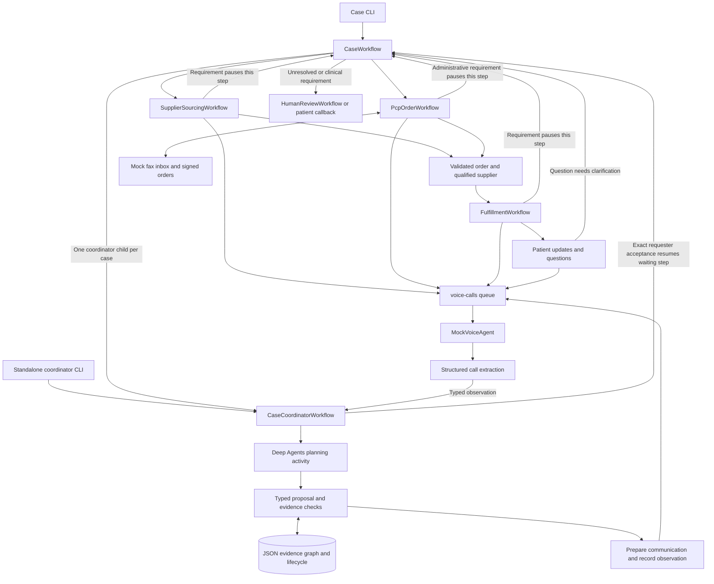
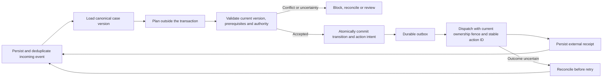

# Architecture and reliability direction

This document describes the implementation at 18 November 2026 and the product decisions guiding its next steps. Future requirements are identified explicitly; the current JSON prototype does not provide distributed transactional guarantees.

## Implemented composition

The normal demo and standalone coordinator use the configured Temporal connection. Automated tests run the same workflows on local time-skipping servers, with scripted model responses. No additional simulation parent is required. The former prerequisite simulation runner was removed after coordination moved into the actual case; its live results remain historical evidence in `SIMULATION_RESULTS.md`.

The DME case owns one coordinator child for supplier and administrative PCP requirements and patient questions. A shared JSON evidence graph records source observations, applicable patient permission, forwarding and explicit requester acceptance before the waiting step resumes. See [MIDRUN_COORDINATION.md](MIDRUN_COORDINATION.md) for the supplier sequence. Clinical/unclear requirements remain human work.

## State and authority today

| Concern | Owner | Current implementation and limit |
|---|---|---|
| Case execution, waits and retries | Temporal | Durable workflow history, timers, signals and child workflows |
| Follow-up tasks, evidence and receipts | JSON case document | Per-case file locks, atomic replacement, versions and stable event/turn IDs on a shared local filesystem |
| Next administrative action | Coordinator model | Bounded proposal, reconstituted from the document each turn; intermediate graph scratch state is not persisted |
| Permission to change business state | Application checks | Exact consent/evidence and version checks; clinical intent routing is not yet comprehensively encoded in code |
| External communication and booking | Mock providers | Real provider delivery guarantees, identity checks and reconciliation are absent |
| Human review | Review workflow and callback store | Explicit review lifecycle; the older callback JSON store is not a multi-writer transactional system |
| Traces | JSONL, readable timelines and Temporal histories | Independent case traces with actual and simulated timestamps; prototype artifacts are not a production telemetry platform |

The coordinator cannot write the real case file through its built-in scratch filesystem. Its proposal tool submits data; application code decides whether to commit. The original DME case also has workflow-owned state, so the expanded product must define a common canonical business model rather than introducing independently editable copies in the agent, workflow and database.

## Reliability policy: safety over liveness

The desired behavior is to make progress only when the relevant prerequisites are established. For example:

- A reported ETA is not a scheduled delivery.
- Offering an appointment is not booking it; booking is not attendance or report acceptance.
- Accepting one quote does not accept another price.
- Receiving a report does not establish clinical sufficiency.
- A provider timeout does not establish that a call or booking failed.

Unknown or conflicting evidence must produce a visible blocked/review state and an owned follow-up. The system should explain what it is waiting for, schedule bounded reminders and provide an authorized human route. It must not silently close an unresolved obligation, create a fictitious success, or repeatedly contact the patient merely to keep a workflow moving.

The clinical-routing failure in the first live evaluation shows why this policy must extend beyond prompts. A model can produce schema-valid output while choosing the wrong process. Add a structured clinical-review requirement, actor authority and task-specific transition rules, then test them independently of the planner. Such a flag must come from an authorized source or a conservative review process; the agent must not clear its own safety restriction.

## Reliability policy: consistency over availability

Here, consistency has two related meanings: authoritative state must not diverge, and the agent should meet the same business invariants across paraphrases, timings and retries. A coherent database alone does not make model decisions semantically consistent; both require evaluation.

For consequential operations, prefer waiting or a retryable refusal to acting on a stale snapshot. This is a product choice, not a claim that the local JSON implementation is a distributed CP database. During a storage or ownership failure, the future system should stop affected mutations. Read-only status may remain available if its freshness is explicit. A read-only replica or cached summary must never authorize a booking or changed terms.

The present adapter serializes local writes and rejects stale versions. Production needs durable conditional writes, suitable read/write consistency and case ownership across workers. A client should receive an acknowledgment only after its input is durably accepted; if that is impossible, return a retryable outcome rather than claiming the message was processed.

## Intended transition and dispatch contract

This is the target contract for real external tools. Today, mocked receipts can be committed inside the JSON transition, and communication activities dispatch the mock call afterward. That ordering is acceptable for the fixture but does not establish exactly-once real-world effects.

Use one canonical case version, an append-only evidence/action ledger and a single logical writer. Produce plans outside the lock; use compare-and-set at commit. Bind approvals to the exact relevant terms and invalidate them when those terms change. Preserve source identity, timestamps and superseded evidence rather than overwriting contradictory claims. Event and action IDs must survive provider and workflow retries.

Temporal and the document database do not share one atomic transaction. Persist a business transition with its outbox intent, make orchestration activities idempotent, and reconcile event delivery/acknowledgment gaps. If a dispatcher loses ownership or cannot verify current consent and preconditions, it must not execute the action. If a booking may already exist, reconcile using a provider reference before retrying; exactly-once effects cannot be assumed from a successful workflow replay.

## Scaling implications

Scale horizontally **across cases**. Partition by tenant/case ID and preserve a fenced owner for mutations within a case. Read-only policy/document lookups can run in parallel; their results are observations subject to validation, not independent authority to act.

Move from local JSON to a document-store adapter only when it can enforce the required conditional writes and consistency. A lease alone is insufficient without fencing stale workers. Do not rely on two workers sharing an in-memory mutex or on active-active agents merging competing bookings later. Retain the document contract so the prototype can evolve without moving business truth into model memory.

Per-case serialization does not solve cross-case resource conflicts. Appointment slots, supplier inventory and communication capacity need provider reservations or another authoritative constraint. Bound phone concurrency and shared provider/token limits. Apply backpressure when capacity is exhausted instead of dropping obligations or reassigning an action to an unfenced worker.

This design sacrifices some per-case throughput and write availability during partitions or uncertainty. It permits unrelated cases and read-only work to continue. Its operational costs include reconciliation queues, review ownership, storage availability requirements and measurable recovery procedures. Never promise identical wording from an LLM; require repeatable safety invariants and consistent task outcomes instead.

## Ordered product roadmap

These are advancement gates, not independent promises to start new integrations on a date.

1. **Coordinator behavior.** Preserve intent, route clinical requests, reduce redundant questions, maintain task dependencies and communicate useful milestones. Repeated tests must cover delayed/duplicate replies, changed terms, missing evidence, multiple simultaneous tasks and human recovery.
2. **Policy and business safeguards, including online checks.** Encode allowed transitions, actor authority, clinical-review requirements, approvals and contact budgets. Add durable dispatch/reconciliation. Run online assertions for unsupported advancement, conflicting actions, missed obligations and excess contact. Async model judges may flag or route; they do not authorize mutations, invent evidence or automatically rewrite policy.
3. **Observability and evaluation.** Build on existing traces with case/task/event/action/provider IDs and versioned prompts, tools, policies and models. Maintain reviewed offline datasets and repeated robustness runs; add shadow/canary evaluation, sampled human review and outcome-based alerts. Separate planner quality, guard interventions, provider failures and eventual patient outcomes. Keep raw sensitive data controlled rather than indiscriminately exporting it to traces.
4. **Model updates.** Evaluate candidate versions against the same data and invariants, pin releases, canary with rollback and compare decision consistency. Promote only when safety gates pass; schema adherence and speed alone are insufficient. Treat prompt/tool-schema changes as releases too. Model outages should create bounded waits or review, not unvalidated fallback decisions.
5. **Voice integration.** Start with one bounded call type. Add identity/consent handling, transcripts, call windows, receipts and failure classification. Separate telephony execution from extraction so model retries cannot repeat successful calls. Expand only after the coordinator and policy gates hold on realistic conversation data.
6. **Additional capabilities and channels.** Add email, asynchronous patient/office chat, document and fax exchange, scheduling and authorized payer checks through the same inbox/outbox contracts. Preserve thread/case correlation, recipient permissions and channel-independent action IDs; deduplicate a reply received by phone and chat. Add specialist agents only when context or permission boundaries improve measurable outcomes.

The product's eventual success measure is the patient receiving the appropriate equipment with understood next steps and costs. The current milestone is scheduling. Expand the outcome model to delivery receipt, setup and unresolved patient issues as the underlying tools become trustworthy, while maintaining an advocate/clinician exception inbox with clear ownership and evidence.

## What the evidence supports

The direct live evaluation passed 4/5 scenarios and exposed clinical misrouting. A historical prerequisite simulation passed 5/5 and exported 27 histories. Those small scripted live runs do not establish reliability for the current case-owned coordinator. The retained tests exercise the real case with mock calls and scripted model/extraction responses, including delayed replies, task-specific reviews, contact budgets, supplier rejection/correction, PCP requests and patient questions. The current suite contains 92 tests.

See [WRITEUP.md](WRITEUP.md), [COORDINATOR_EVAL_RESULTS.md](COORDINATOR_EVAL_RESULTS.md), [SIMULATION_RESULTS.md](SIMULATION_RESULTS.md), and [MIDRUN_COORDINATION.md](MIDRUN_COORDINATION.md) for scope and evidence.
