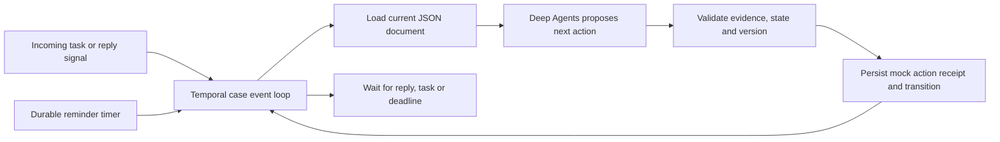

# Minimal Deep Agents coordinator

This implements an agent that supervises ongoing administrative follow-ups on Temporal. It is an additional demo alongside the original DME workflow. Voice remains the original mock implementation; this coordinator's communication and booking effects are also mocked and recorded as JSON receipts.

## Framework decision

Use `deepagents.create_deep_agent` for the bounded reasoning/tool loop and Temporal for the long-running case. Deep Agents runs on LangGraph and provides planning and tool execution. It supports adding specialist capabilities later. Plain LangChain `create_agent` would be sufficient for this small initial tool set; Deep Agents is used here to exercise the proposed harness without committing to a multi-agent design.

The extra harness includes scratch filesystem and delegation machinery, model calls, and additional dependencies. Those are overhead for this version. There are no custom specialist agents, no shell backend, and no filesystem backend connected to the project: scratch files cannot mutate business state. The coordinator prompt directs the agent not to delegate; correctness does not depend on its scratchpad or todos.

One real model turn chooses one action through tools. The application validates and executes that proposal. A new external event can change which task is next; the business sequence is not hard-coded into graph edges.

Sources: [Deep Agents overview](https://docs.langchain.com/oss/python/deepagents/overview), [customization](https://docs.langchain.com/oss/python/deepagents/customization), [backends](https://docs.langchain.com/oss/python/deepagents/backends), [Temporal durable AI](https://docs.temporal.io/ai).

## Runtime and JSON persistence



- `runtime/coordinator/<case-id>.json` is the authoritative document: task lifecycle, inbound events, mock slot offers, proposed/accepted actions, reasons, and receipts.
- Cross-process file locks serialize updates; unique temporary files and atomic replacement avoid partial writes. Document versions reject stale plans. Stable turn IDs and event IDs deduplicate retries.
- Temporal persists signals, waiting, timers, model-activity retries, and continuation. A model call runs only when there is ready work. Default reminder interval is one day. After four unanswered contact attempts, the task requires human review.
- A reply arriving during model planning invalidates that plan before the apply step. Completed tasks are not automatically reopened by late messages.
- All tasks can finish while the coordinator stays running: a later `add_task` signal gives it more work. `close` explicitly ends supervision. Continue-as-new preserves the case document while bounding workflow history.
- Each agent turn reconstructs context from the JSON document. Intermediate LangGraph scratch state and model conversation are **not** checkpointed to JSON. If a model turn fails, Temporal retries it from the current document; no outbound action occurs during planning. This is application-level persistence, not a custom LangGraph checkpointer.

For this assignment, think of the JSON store as a document DB adapter. Workers must share the same local filesystem. It is not a distributed database, and the document/history grow with use. Before real external actions, add an outbox dispatcher, provider idempotency and uncertain-outcome reconciliation.

## Setup and run

The existing Temporal Cloud profile is reused. Select Groq or OpenRouter with `MODEL_PROVIDER`; credentials remain in local environment variables or the ignored `.env` file.

```bash
uv sync
export MODEL_PROVIDER=groq
export GROQ_API_KEY="your-key"
export GROQ_MODEL="openai/gpt-oss-120b"
# Optional: select another model on the same provider that supports tool calling.
# export COORDINATOR_MODEL="your-tool-capable-model-id"
uv run python -m mira.coordinator.worker
```

`COORDINATOR_MODEL` defaults to the selected provider's `GROQ_MODEL` or `OPENROUTER_MODEL`. `MODEL_PROVIDER` selects the endpoint and API key for both extraction and coordination. With no provider configured, the backward-compatible default remains OpenRouter. A model that can return JSON is not necessarily capable of tool calling; select one with that capability. A model/provider failure after retries creates an `awaiting_review` task rather than fabricated progress.

Groq uses its documented OpenAI-compatible endpoint through the existing clients, so no additional SDK is needed. [Groq OpenAI compatibility](https://console.groq.com/docs/openai).

In a second terminal:

```bash
uv run python -m mira.coordinator start eleanor-followups \
  --task-id pt --kind pt_followup \
  --goal "PCP requested a mobility assessment before signing. Arrange the requested visit, obtain the report and confirm PCP acceptance."

uv run python -m mira.coordinator status eleanor-followups
uv run python -m mira.coordinator show eleanor-followups
```

`status` queries Temporal; `show` reads the worker's local JSON document, including its mock communication outbox and booking receipts. If the CLI runs elsewhere, it needs access to that same directory for `show` and escalation import.

The worker may be stopped and restarted. Temporal continues to track the deadline and resumes the workflow when a worker becomes available. Replies can be signaled while the worker is stopped; Temporal retains them.

## PT example: reply hours later

The model should first clarify requirements or ask for patient availability. No real message or call is sent. Inject a mock inbound reply, preserving an event ID when retrying the same delivery:

```bash
uv run python -m mira.coordinator event eleanor-followups --json \
  '{"event_id":"availability-1","task_id":"pt","party":"patient","text":"Afternoons work for me. Please tell me the available appointments."}'
```

Inspect the mock offers in `show`. Initial `slot-1` and `slot-2` are generated at case creation and expire after one day. The event below explicitly accepts an offered slot; a plain message does not grant booking authority:

```bash
uv run python -m mira.coordinator event eleanor-followups --json \
  '{"event_id":"consent-1","task_id":"pt","party":"patient","kind":"slot_accepted","slot_id":"slot-1","text":"I accept the exact slot-1 appointment shown in the offer."}'
```

The agent can now propose `book_visit`; the gate checks the offer, expiry and consent, and records a mock booking reference. A later patient message or changed slot offer requires renewed acceptance. An expired offer must be replaced by a PCP `slot_offered` event with `slot_id`, `slot_starts_at` and `offer_expires_at` (ISO timestamps with timezones), followed by patient acceptance of that offer.

Booking does not finish the report task. After the mock visit:

```bash
uv run python -m mira.coordinator event eleanor-followups --json \
  '{"event_id":"visit-1","task_id":"pt","party":"pcp","kind":"visit_completed","text":"The requested assessment visit took place. The report is being prepared."}'

uv run python -m mira.coordinator event eleanor-followups --json \
  '{"event_id":"report-1","task_id":"pt","party":"pcp","kind":"report_accepted","text":"We received and accepted the requested assessment report. The administrative follow-up is satisfied."}'
```

Only PCP `report_accepted` evidence permits completion of this follow-up. An existing report can satisfy the request without booking a new appointment. The model does not decide clinical sufficiency or write an order.

## Cost example: another task in the same long-running case

```bash
uv run python -m mira.coordinator add eleanor-followups \
  --task-id cost --kind cost_clarification \
  --goal "Patient wants the supplier's actual quote and assignment status explained before accepting."

uv run python -m mira.coordinator event eleanor-followups --json \
  '{"event_id":"quote-1","task_id":"cost","party":"supplier","kind":"quote","amount_cents":2500,"accepts_assignment":true,"text":"For this demo offer, the estimated patient share is $25 and we accept assignment. This is not an eligibility or payment guarantee."}'

uv run python -m mira.coordinator event eleanor-followups --json \
  '{"event_id":"quote-consent-1","task_id":"cost","party":"patient","kind":"quote_accepted","reference_event_id":"quote-1","text":"I accept the quoted demo terms that were explained to me."}'
```

A newer quote invalidates acceptance of an older one. This completes quote clarification only; it does not establish eligibility, submit a claim, or guarantee coverage. There is no Medicare policy search or beneficiary portal integration in this increment.

## Reviews, existing escalations and lifecycle

Use `request_human_review` for clinical judgment, unclear instructions, conflicting consent or exhausted automation. The gate also turns unsupported model actions into reviews. Human authority and evidence are represented by typed mock events; there is no authentication in this prototype. The message's claimed sender is not verified against an external system.

```bash
uv run python -m mira.coordinator event eleanor-followups --json \
  '{"event_id":"review-1","task_id":"pt","party":"human","kind":"human_resume","text":"Clarified the office request. Continue administrative coordination."}'

uv run python -m mira.coordinator close eleanor-followups
```

`human_cancel` cancels one task. Ordinary inbound replies do not automatically clear a task awaiting human review.

`start` and `add` accept `--escalation <id>` to attach the original escalation as provenance. That manual bridge does not close its existing human review or mark a case clinically ready. Separately, DME sourcing, PCP order chasing and fulfillment signal administrative requirements to one case-owned coordinator child. Patient questions use the same `information_requirement` task. Its requester may be supplier, PCP or patient; only that requester can accept the current forwarded reference. Patient permission is required when her information goes to a third party. Blocking steps resume after clearance; unresolved patient questions become callbacks before case completion. See [MIDRUN_COORDINATION.md](MIDRUN_COORDINATION.md); the voice agent remains mocked.

## Verification and scope

Five additional live evaluation scenarios are defined in `data/coordinator_eval/scenarios.json`: delayed PT reply,
expired slot, unaffordable quote, superseded quote, and a clinical-judgment boundary. Run them sequentially:

```bash
uv run python -m mira.coordinator.evaluate
```

The runner spaces individual model requests, honors Groq token-reset headers, and backs off on 429 responses.
It records proposals, committed actions, task outcomes, token usage, and per-stage expectations under
`runtime/coordinator_eval/<run>/report.json`. The parties and time advancement are scripted; this evaluates
the real Deep Agents planner and production activity/JSON path, not new Temporal Cloud executions or real
service delivery. Failed intermediate decisions remain failures even when a later event enables completion.

The first live five-scenario run passed 4/5 scenarios and 11/12 decisions, with no rate-limit responses.
The clinical-request case failed to escalate and drifted into appointment questions. See
[COORDINATOR_EVAL_RESULTS.md](COORDINATOR_EVAL_RESULTS.md) for the preserved result and patient-experience findings.

Tests cover the real Deep Agents graph using a fake tool-calling model, including its use inside the Temporal lifecycle; JSON reload; duplicate-event and turn deduplication; stale versions; expired and revised slot offers; explicit patient consent; PCP report evidence; superseded quotes; late replies; reviews; and durable reminder wakeups across multiple simulated days. The original assignment tests remain included.

Live checks on 18 November: OpenRouter returned `429 free-models-per-day`; Groq's `qwen/qwen3.8-27b` was available but repeatedly produced malformed tool calls rejected by Groq. Switching to Groq's `openai/gpt-oss-120b` succeeded on the same generic appointment-availability prompt: the actual Deep Agents loop returned a schema-valid contact action with the correct task ID, patient recipient, reason and message. This is a smoke test, not a statistical model evaluation. Tests never need model credentials.

There are now three task types, all with mocked communication/booking. Supplier information tasks additionally require explicit administrative scope; clinical or unknown source flags trigger review before contact. Model extraction can still misclassify language, so this is not a complete medical safety policy. Real clinical use requires stronger review and integration controls. No voice-provider work, DB server, UI, portal access or custom JSON LangGraph checkpoint format was added.

## Current case integration status

The current suite passes 99 tests, including task-specific reviews, failed-turn handling, contact/action budgets and all three requester roles. Ordinary replies from the contacted party reset only unanswered contacts, not the total action budget; human resume resets both. A rejected proposal reviews its named ready task, while failed or unattributable turns conservatively review all ready tasks.

Saved live evidence confirms the PCP report loop and scheduling. The default case also scheduled delivery with a patient callback after acceptance extraction failed; the latest prompt change remains unverified live. The written-order exception needs narrowing to preserve compound requirements. [ARCHITECTURE.md](ARCHITECTURE.md#current-review-and-verification) records the current review and remaining findings. No model calls were made during this review.
