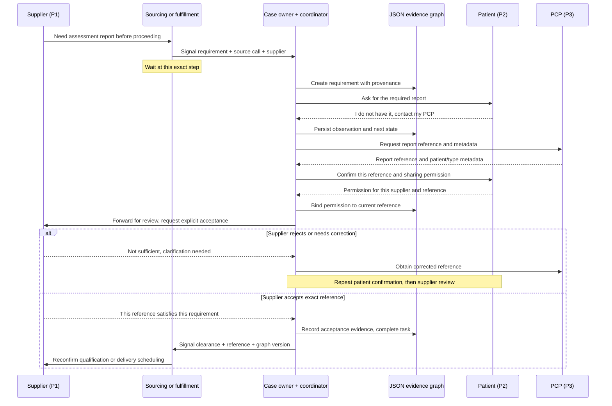

# Coordination inside the DME workflow

One case-owned coordinator resolves administrative requirements from a supplier, PCP or patient. Sourcing, order chasing and fulfillment can pause at the exact request, then resume the same child workflow after requester acceptance. Patient questions run alongside fulfillment and must be answered or handed to a callback before the case finishes. The old prerequisite simulation runner is retired; the normal case is the integration path.

| Requester | Example | Resume or fallback |
|---|---|---|
| Supplier | Existing assessment report before proceeding | Patient → PCP if needed → patient permission → supplier acceptance, then recheck qualification/scheduling |
| PCP | Copy of an existing PT evaluation before signing | Patient supplies reference and permission → PCP accepts → order chase asks for signature |
| Patient | Estimated dollar amount of cost share | Supplier provides estimate → patient explicitly accepts the answer, or a callback is created |

A request for a new clinical assessment or an unclear requirement goes to human review. The supplier sequence below illustrates the general pattern.

## Conversation and workflow ownership



The coordinator chooses each next party/action from current evidence. The sequence above is a tested example, not a hardcoded conversation path. A patient who already has the document can provide it directly. A rejection can lead back to the patient or PCP. Temporal runs bounded planning and call activities, persists orchestration history, and waits on signals/reminder timers rather than holding a model conversation open for hours.

`CaseWorkflow` creates one `CaseCoordinatorWorkflow` child on its first requirement. Sourcing, PCP order chasing, fulfillment and patient questions reuse that child and its graph. Their original workflow state remains owned by Temporal; the follow-up's facts, permissions, actions and lifecycle live in JSON. The case status query includes coordinator workflow/state IDs and pending requirement IDs. Independent cases have independent documents.

## Minimal ontology in JSON

The document under `runtime/coordinator/dme-<workflow-hash>.json` contains requirements, documents, observations, contacts, actions and call results. Typed nodes/edges express:

- requester (supplier, PCP or patient) **requires** requirement, linked to the source call and requesting workflow;
- a party other than the requester **provided** a reference, with its source event;
- patient **authorized_for_requester** this exact reference and requirement (not needed when the patient is the requester);
- reference **forwarded_for_requester_review** to that requester;
- requester **accepted** this exact reference, with its response event.

These are source-attributed claims. A document reference is opaque; the system checks matching patient/type metadata but does **not** read, authenticate or clinically validate document contents. References must identify immutable document revisions; content-changing reuse of a reference cannot be detected by this prototype. A later document-processing tool should add its own versioned observations, leaving the original evidence intact.

Replacing the reference invalidates earlier sharing permission and requester acceptance. Plain information is forwarded with its actual source facts, and cannot substitute for a requested document. Receipt, a generic “looks fine,” an unrelated acceptance, or an agent's own summary cannot clear the requirement. After acceptance, the original child must still obtain a fresh qualification/scheduling result; document acceptance itself is not fulfillment.

## Safety and limits

For requirements admitted to the coordinator, only a source requirement explicitly classified as administrative (`clinical_decision_required=false`) enters autonomous coordination. True or unspecified scope starts in review. Clinical observations, conflicting patient/type metadata, revoked sharing permission, failed communications and exhausted budgets also block clearance of that requirement. Blocking supplier/PCP requirements use the existing human review path; unresolved patient questions become nonblocking callbacks. This is a conservative structured gate, not a guarantee that model extraction recognizes every clinical request.

Clarification is bounded: 16 actions per task (reset only by a human resume), 4 consecutive contacts the contacted party has not answered, three sourcing clarification rounds and a gate deadline of 14 scaled days (at least 30 minutes). Multiple obligations are serialized through one coordinator; loops do not require more specialist agents. A human retry reruns the affected original track with fresh task provenance; it does not let the model clear an immutable clinical restriction.

Existing receive signals can carry delayed typed observations. Email/chat adapters would authenticate the sender, correlate case/task/reference IDs, and submit the same observation contract. These transports are not implemented. Completed tasks retain late replies as evidence without automatic reopening; this version does not roll back fulfillment after a late revocation or globally reconcile every PCP exception. Those require a case-wide invalidation/review policy before production use. The routine written-order filter currently also drops compound requests mentioning that order; see the concrete finding in [ARCHITECTURE.md](ARCHITECTURE.md#remaining-review-findings).

JSON uses local file locks, atomic replacement and version checks. Scale across cases; do not put independent machines behind separate copies of the same file. A production document store must preserve conditional writes and one fenced case owner. Real external actions also need a durable outbox, recipient authentication, provider idempotency and uncertain-outcome reconciliation. Stable mock call IDs and Temporal retries alone do not guarantee exactly-once real phone calls. These limits preserve the distinction between the implemented prototype and the desired safety/consistency contract.

## Reproduction and evidence

```bash
# Normal configured Temporal connection; mock voice, live model planning/extraction.
SCENARIO=supplier_information uv run python -m mira.worker
# In another terminal:
uv run python -m mira.start_case

# Local Temporal test server; scripted model/extraction, no model credentials.
uv run pytest -q tests/test_supplier_coordination.py tests/test_case_requirements.py tests/test_coordinator_budgets.py
```

The new fixture drives the sourcing → patient → PCP → patient → supplier loop. Main worker registration includes the coordinator and communication activities, so a separate coordinator worker is unnecessary for this case-owned child.

The automated suite has **99 tests**. Additional real-case tests cover administrative PCP requests, patient cost questions and task/contact-budget guards. Supplier coverage includes sourcing, fulfillment, both phases sharing one coordinator/document, rejection and replacement, patient permission, wrong-reference/receipt-only acceptance, metadata mismatch, document-vs-information constraints, and clinical/unknown requests reaching human review without autonomous coordination calls. Tests run actual local time-skipping Temporal workflows and the Deep Agents graph with scripted tool-call responses. They export per-workflow timestamped histories to pytest temporary directories. Existing live Cloud/Groq evidence includes a completed PCP requirement and scheduled delivery, plus a default run that scheduled delivery while handing an unaccepted patient answer to a callback. The latest acceptance-prompt change awaits live verification. This review made no LLM requests; quota was exhausted. Earlier five-case live results evaluate the prior prerequisite composition. See [current verification](ARCHITECTURE.md#current-review-and-verification) for timestamps and evidence limits.

Implementation: `mira/workflows/requirement_gate.py` holds the pause/resume gate; `mira/workflows/case.py` owns the coordinator; `mira/coordinator/agent.py` chooses actions; `knowledge.py` reconciles evidence; `store.py` checks transitions; `communication.py` prepares mock calls and records extracted observations.
