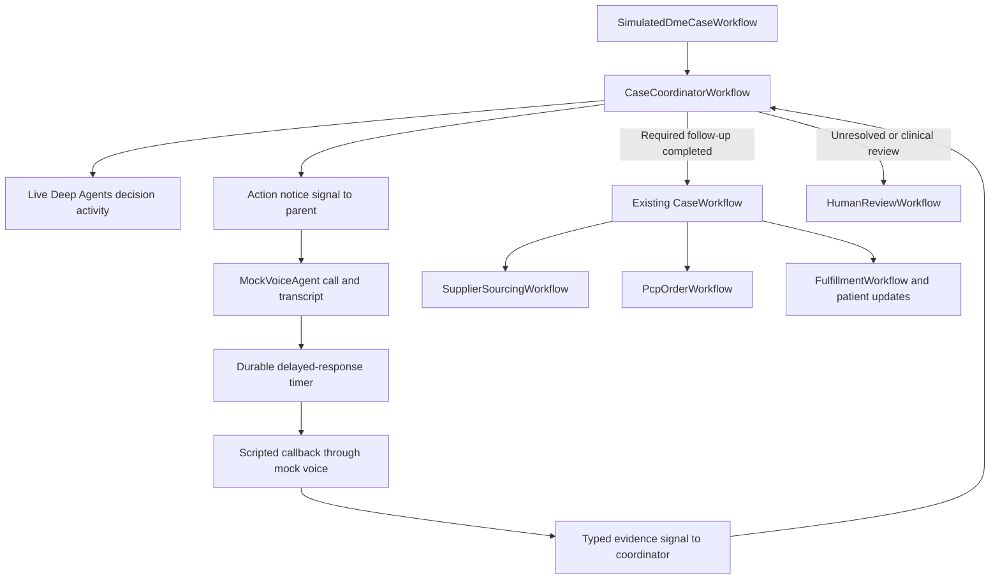

# End-to-end Temporal and coordinator simulations

Run the five scenarios through actual Temporal workflows, the Deep Agents coordinator, mock voice calls,
the existing DME workflows, and signed-order/fax mocks:

```bash
uv sync
uv run python -m mira.simulation.run
```

The selected `MODEL_PROVIDER` and provider key are used for live coordinator reasoning **and** extraction
of the DME call transcripts. Cases run sequentially; model requests share the existing rate-limit pacer.
The coordinator turn ends when its action proposal is submitted, avoiding an unnecessary final model call.

## Workflow composition



The simulation parent makes the coordinator's follow-up a prerequisite for the DME case. A resolved
assessment/report or cost question unblocks order chasing, supplier screening, handoff, delivery confirmation,
and patient updates through the existing `CaseWorkflow`. All resulting phone calls use the existing
`MockVoiceAgent` interface, wrapped to record transcripts. The normal production voice implementation is unchanged.

The original DME prototype ends at **delivery scheduled**, not physical delivery or claim payment. Here,
supplier availability and a valid signed order are scripted to become available once the prerequisite completes.

## Time, server and traces

Each case runs in its own real local Temporal time-skipping test server, with workers and a client.
No Temporal Cloud execution is claimed. Temporal timers accelerate simulated six-hour and multi-day waits;
real model requests and their rate-limit waits still take wall-clock time. This is more integrated than the
earlier direct-activity evaluation. Time-skipping behavior is described in the
[Temporal Python testing documentation](https://docs.temporal.io/develop/python/best-practices/testing-suite).

The completed live run is summarized in [SIMULATION_RESULTS.md](SIMULATION_RESULTS.md).

The coordination delays use actual simulated hours/days. The downstream DME child retains the existing
demo scale of 60 Temporal seconds per service day; its `seconds_per_day` input is included in the history.

Every scenario gets an independent folder under `runtime/e2e/<run>/<scenario>/`:

- `trace.html`: filterable event timeline with call transcripts and state/action details.
- `trace.md`: readable text version.
- `trace.jsonl`: timestamped raw events.
- `result.json`: stage checks, coordinator outcome, final DME result, and workflow IDs.
- `state/`: independent JSON coordinator documents.
- `histories/`: raw histories for the parent, coordinator, DME children and any human review.

The run-level `index.html` links all five filterable timelines; `index.md` is the text alternative.

Raw timestamps are UTC. Human-readable timelines display IST (Asia/Kolkata). Each event records actual
wall time and a simulated business timestamp from the workflow or activity scheduling context. Detailed
activity scheduling/completion and retry-attempt metadata remain available in the original Temporal histories.
Temporal may compact intermediate activity failures; the timeline highlights retry attempt numbers separately.

## What remains scripted

External parties, appointment offers, signed orders, fax transfer, stock and delivery scheduling, and human
responses are synthetic. Coordination callbacks include typed evidence alongside their mock transcript;
that metadata is supplied by the mock-provider fixture, not falsely claimed as inferred by a live extractor.
DME screening/order/patient call transcripts are interpreted by the live selected model.

The stage checker preserves a wrong agent decision even if a simulation-level guard later hands the case
to a human. An unresolved or clinical case cannot enter the DME fulfillment workflow. A separate mock human
responds to a real `HumanReviewWorkflow` after a durable one-hour timer; the trace labels that decision as mocked.
This guard is not counted as successful clinical routing by the coordinator if the coordinator failed to ask.

The five scenarios retain their earlier expectations. Clinical routing is not silently repaired to force
the test to pass. Scripted tests verify both a correct review and the known wrong-routing behavior.
