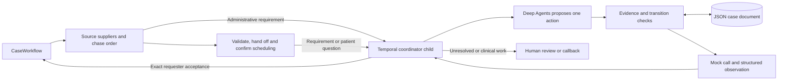

# Automating DME coordination

The hard part of Eleanor's wheelchair case is keeping obligations moving across the patient, PCP and supplier. A supplier can stop answering, an order can contain the wrong code, and a patient can misunderstand the cost. The prototype works those handoffs through delivery scheduling and returns unresolved work to a person.

I built supplier sourcing and PCP order chasing first, in parallel, then order validation, supplier handoff, fallback and patient updates. I added one case-owned coordinator for conversations whose next step depends on another party's answer. The fixed workflows retain bounded procedures; the agent chooses the next administrative coordination action.

Python and Pydantic define the contracts. Temporal owns case execution, retries, signals, timers and human review. Deep Agents supplies the LangGraph tool loop, with Groq `openai/gpt-oss-120b` currently selected for planning and transcript extraction. `MODEL_PROVIDER` also supports OpenRouter. JSON serves as the minimal document store: tasks, evidence, permissions and action receipts survive model turns, with local file locks, atomic replacement, deduplication and version checks. The model's scratchpad is not business state.

The supplier can ask for a report during sourcing or fulfillment. That step pauses while the coordinator contacts the patient, requests an existing report from the PCP if needed, obtains the patient's permission for the current reference, and asks the supplier to accept it. Rejection can start another correction loop. Administrative PCP requests use the same mechanism; acceptance resumes the order chase. Patient cost questions run alongside fulfillment, but the case settles them as answered or hands them to a callback before finishing. A new clinical assessment remains human work.

AI extracts facts and proposes actions. Code decides whether to commit them: exact requester acceptance, applicable patient permission, matching document metadata, supplier qualification, order consistency and explicit scheduling evidence are enforced outside the planner. A replacement reference invalidates previous permission and acceptance. Rejected proposals review the task they targeted; an unattributable failed turn reviews all ready tasks. Only replies from the contacted party reset unanswered-contact counts, and a separate 16-action budget bounds each task until human resume.

The product posture is **safety over liveness and consistency over availability**. Missing consent or uncertain evidence should leave an owned obligation, not produce speculative success. Temporal waits between turns, so a reply hours later does not require an open model request. JSON holds follow-up facts and lifecycle; Temporal holds orchestration progress. Scale across cases, retaining one logical writer within a case. A future document database needs conditional writes and fenced ownership; during a partition, pause affected mutations instead of accepting conflicting decisions. Local JSON is not a distributed consistency solution. Real tools also require an outbox, provider idempotency and reconciliation of uncertain outcomes: Temporal replay alone cannot guarantee exactly-once phone calls.

Verification separates orchestration from model quality. **99 automated tests pass**, using local Temporal servers and scripted model/extraction responses. Saved live Cloud evidence shows the PCP report request cleared, the corrected order was validated and delivery was scheduled. A live default case scheduled delivery but handed an unconfirmed patient answer to a callback. Its latest acceptance-prompt change remains unverified live because daily model quota was exhausted. A written-order filter prevents redundant coordination, but currently also suppresses compound requests mentioning that order; narrowing it is a remaining policy gap. Earlier live evaluation scored 4/5, including a clinical misroute; a later 5/5 prerequisite simulation is historical evidence, not proof of current reliability. That separate runner has been removed. Details are in [ARCHITECTURE.md](ARCHITECTURE.md).

Calls, fax, external parties, booking and delivery outcomes are mocked. The normal demo makes real LLM calls; tests do not. Document references are opaque: metadata checks do not read, authenticate or clinically validate a report. The case ends at delivery scheduled, not receipt or claim payment. Auth, a database server, UI polish, live Medicare/eligibility checks, real communications and specialist agents were cut to focus on coordination. Passing order consistency checks does not establish coverage or medical necessity. [README.md](README.md) gives the demo commands and scenario choices.

Further work, in order:

1. **Coordinator behavior:** verify the patient-acceptance fix, reduce repeated questions and test delayed, conflicting and revised replies.
2. **Policy and business safeguards, including online checks:** narrow the written-order filter, strengthen clinical routing, and detect unsupported progress or excess contact. Online evaluators may flag or pause; they cannot authorize actions or rewrite policy.
3. **Observability and evaluation:** correlate case/task/event/action IDs, record model/prompt/policy versions, and add repeated offline runs, shadow evaluation and human review.
4. **Model updates:** compare pinned candidates against the same safety gates, then canary with rollback before optimizing cost or latency.
5. **Voice agent:** integrate one bounded call type with identity, consent, transcripts and action reconciliation.
6. **Additional tools:** add email, asynchronous chat, document exchange, scheduling and authorized payer checks through the same event/action contracts.

With **one more day**, close the two observed policy/extraction gaps and repeat the real-case demos when quota allows. With **two weeks**, strengthen dispatch/reconciliation and outcome-based evaluation, then begin a bounded voice integration if those gates pass. Additional channels follow demonstrated reliability rather than a calendar promise.
