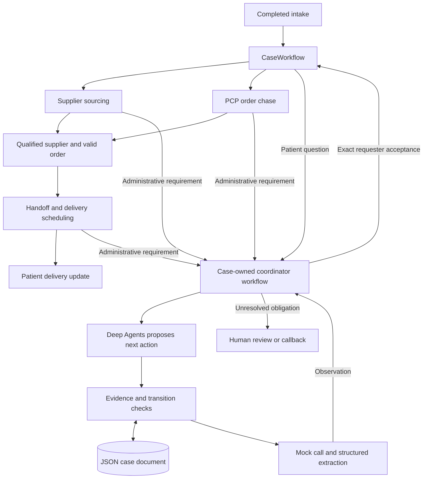
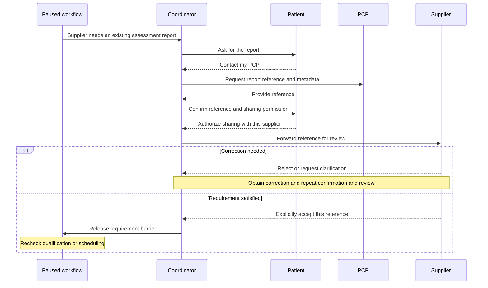

# DME Coordination System Design

## 1. Problem statement

A patient who needs durable medical equipment must coordinate with a primary care provider (PCP) and a supplier. The PCP holds the written order and clinical documentation; the supplier holds availability and delivery information; the patient needs clear next steps and an explanation of potential costs. Missing paperwork, unanswered calls and contradictory information can stall the case for days.

This prototype works Eleanor Martinez's standard manual wheelchair case (HCPCS K0001) from completed intake through **confirmed delivery scheduling**. It automates administrative coordination and returns clinical decisions or unresolved obligations to a person.

The design combines bounded business workflows with an agent that chooses the next communication step when a case needs clarification. Temporal provides durability; the agent provides conversational flexibility.

## 2. Requirements and scope

### Functional requirements

| Requirement | Expected behavior |
|---|---|
| Find a supplier | Call the supplied directory, confirm acceptance, stock, service area and willingness to take the case; retry unanswered calls and rank qualified candidates |
| Obtain the written order | Contact the PCP, resend a lost request, follow up on delays, and request corrections when the returned order is inconsistent |
| Coordinate fulfillment | Hand off a valid order, require explicit scheduling evidence, and use a backup when a supplier stops responding |
| Resolve administrative requirements | Pause the affected step, contact patient/PCP/supplier as needed, and resume only after the requester accepts the current information |
| Keep the patient informed | Explain progress, next steps and conditional cost share; resolve questions or create an owned callback |
| Involve a human when needed | Keep blocking reviews visible and support explicit retry or closure; preserve nonblocking patient callbacks |

### Reliability requirements

- **Safety over liveness:** uncertain evidence, missing permission or a clinical decision must prevent automatic clearance.
- **Consistency over availability:** reject stale proposals rather than commit conflicting business state.
- **Durability:** preserve pending obligations across worker restarts and replies arriving hours or days later.
- **Bounded autonomy:** limit unanswered outreach and total actions; stop loops that cannot establish progress.
- **Traceability:** retain source events, document references, decisions, receipts and workflow history.

### Scope boundary

Intake is already complete. Calls, fax, external parties, appointment booking and delivery outcomes are mocked. The normal demo uses real LLM planning and transcript extraction; automated tests use scripted responses. The implementation does not verify Medicare eligibility, determine medical necessity, submit claims, confirm physical delivery or interpret clinical findings.

## 3. High-level design

Supplier sourcing and order chasing run in parallel. Fulfillment starts once a qualified supplier and a valid order are available. A supplier or PCP requirement pauses the affected child workflow, while the case-owned coordinator works the clarification. Patient questions can run alongside fulfillment; before the case finishes, they must be answered or handed to a callback.

### Components and responsibilities

| Component | Responsibility |
|---|---|
| `CaseWorkflow` | Own the case, compose child workflows, create one coordinator when needed, route resolutions and settle patient questions |
| Sourcing, PCP and fulfillment workflows | Execute bounded procedures, expose progress, and pause at requirements requiring another party's input |
| `CaseCoordinatorWorkflow` | Supervise open tasks, invoke planning/execution activities, and wait for observations or reminder deadlines |
| Deep Agents planner | Read current evidence and propose one next administrative action |
| JSON store and evidence graph | Persist task lifecycle, source claims, permissions, accepted references and action receipts; validate transitions |
| Communication activities | Resolve the intended contact, prepare a mock call, and reconcile its extracted response |
| Human review and callback inbox | Retain ownership of work that automation cannot safely resolve |

Python and Pydantic define typed boundaries. Deep Agents supplies the LangGraph tool loop. Groq `openai/gpt-oss-120b` is the configured model; `MODEL_PROVIDER` also supports OpenRouter. JSON avoids a database deployment for the assignment. The [README](README.md) contains setup and scenario commands.

## 4. Agentic architecture

### One coordinator with scoped tools

One coordinator serves a case's supplier, PCP and patient requirements. Separate agents per party would add ownership and reconciliation problems before demonstrating a measurable benefit. Specialist agents remain a future option for distinct context or permission boundaries.

Each planning turn reconstructs context from the authoritative JSON document. The custom tools are:

| Tool | Purpose |
|---|---|
| `get_case` | Read tasks, observations and prior actions |
| `available_slots` | Read mock appointment offers for standalone follow-ups |
| `propose_action` | Submit one typed proposal for runtime validation |

Actions include contact, forward information, wait, request human review and complete; standalone follow-ups also support mock booking. The model does not directly edit business state or place calls through these tools. Deep Agents scratch files and todos are not authoritative, and there are no custom specialist subagents.

### Multi-party coordination loop

A requirement records its requester, source call and owning workflow. Only that requester can accept its resolution. Other parties supply information, with patient permission required when sharing her information with a third-party requester.

The next contact is chosen from current evidence, rather than a fixed conversation script. A patient who already has the report can supply it directly. A PCP request for an existing report follows the same mechanism, with the PCP as requester. A patient cost question routes to the supplier, then back to the patient for acceptance of the answer.

### Guardrails outside the model

Application code checks current version, task readiness, source scope, actor role, applicable permission, document metadata and exact requester acceptance. Receiving a document is not acceptance; acceptance is not delivery scheduling. A new reference invalidates previous permission and acceptance.

Requirements enter autonomous coordination only when their extracted scope is explicitly administrative. Clinical or unknown scope starts in review. A rejected proposal reviews the targeted task; an unattributable failed turn reviews all ready tasks. Only a reply from the contacted party resets unanswered contacts. Four unanswered contacts and a separate 16-action budget bound task execution; human resume resets the budgets.

These checks constrain model output, but cannot guarantee that extraction correctly understands every clinical statement. The written-order exception also has a known gap described below.

## 5. Temporal execution and recovery

Temporal supplies the long-running execution layer. Model turns are bounded activities; the system does not leave an LLM request open while waiting for a reply.

| Mechanism | Use in this design |
|---|---|
| Child workflows | Separate supplier sourcing, PCP order chase, fulfillment, coordinator supervision and blocking human review |
| Signals | Deliver requirements, observations, resolutions, incoming orders and human decisions |
| Durable timers | Schedule callbacks, reminders and deadlines without keeping a process asleep in memory |
| Activities and retries | Execute model calls and external adapters outside deterministic workflow code |
| Queries and history | Expose current status and retain the orchestration record |
| Worker queues | Separate case orchestration (`dme-cases`) from call execution (`voice-calls`); the standalone coordinator has its own queue |

A requirement barrier retains the waiting step until the coordinator returns clearance or review. The default deadline is 14 scaled case days, with a 30-minute minimum. Clearance resumes the original child; it does not rerun the entire case or itself establish qualification, a valid order or delivery scheduling.

Worker restart recovers orchestration from Temporal history. JSON activity results survive separately in the document store. Stable event and turn IDs deduplicate inputs and committed transitions, but Temporal and JSON do not share a transaction. Real communications will require durable dispatch intent, provider idempotency and reconciliation of uncertain outcomes; replay alone does not guarantee exactly-once calls.

## 6. State management and scaling

| State | Authority |
|---|---|
| Execution progress, waits and child lifetimes | Temporal history |
| Follow-up tasks, observations, permissions and receipts | JSON case document |
| Intermediate reasoning and scratchpad | Temporary planner context |

Task states are `ready`, `waiting_external`, `awaiting_review`, `completed` and `cancelled`. The evidence graph links requester → requirement, source → reference, patient → sharing authorization, reference → forwarding, and requester → acceptance. It stores attributed claims, not a verified clinical ontology.

Local file locks, atomic replacement and version checks serialize document updates. Plans are produced outside the write lock and validated before commit. Document references are opaque and must identify immutable revisions: metadata checks cannot detect contents changing behind the same reference.

Scaling should partition across cases while preserving one logical writer per case. A production document store needs conditional writes and fenced ownership. If authoritative state or ownership is unavailable, pause affected mutations rather than merge competing decisions later. Unrelated cases can continue. Cross-case appointment and supplier capacity require separate authoritative reservations.

Completed tasks retain late replies as evidence without automatically reopening. Case-wide invalidation and rollback after a late revocation remain future work.

## 7. Implemented capabilities and verification

| Capability | Current status |
|---|---|
| Supplier screening, callback attempts, ranking and backup selection | Implemented with mock calls and typed extraction |
| Lost order request, correction loop and order consistency checks | Implemented; passing checks does not establish coverage |
| Handoff, explicit scheduling confirmation and supplier fallback | Implemented; endpoint is delivery scheduled |
| Supplier and administrative PCP requirement loops | Integrated inside the real case, sharing one coordinator |
| Patient question resolution | Supplier clarification followed by patient acceptance, or callback before case completion |
| Human review, retry/close and callback completion | Implemented |
| Evidence/version checks and task/contact budgets | Implemented and regression-tested |
| Real voice, email/chat, document parsing and payer portals | Deferred |

**99 automated tests pass**, using local time-skipping Temporal servers and scripted model/extraction responses. They verify orchestration and guards, not live-model reliability.

Saved live Cloud evidence shows a PCP report request cleared, the order validated and delivery scheduled. A default case also scheduled delivery while handing an unconfirmed patient answer to a callback. Earlier live evaluation scored 4/5, including a clinical misroute; a later 5/5 prerequisite simulation is historical evidence. Its separate runner has been removed. [ARCHITECTURE.md](ARCHITECTURE.md#current-review-and-verification) records timestamps and evidence limits.

### Known gaps

- The written-order filter suppresses compound requests mentioning that order, potentially discarding an additional assessment or correction requirement. It needs narrowing.
- The latest patient-acceptance prompt remains unverified live because daily model quota was exhausted. The explicit-acceptance guard and callback fallback remain in place.
- Document contents, sender identity and clinical sufficiency are not verified. Auth, distributed storage, real communications, claims and physical-delivery confirmation are outside the prototype.

No new LLM calls were made for this document update.

## 8. Future directions

The priority order is coordinator behavior → policy/business safeguards and online checks → observability/evaluation → model updates → voice → additional communication tools. The milestones below are cumulative goals, with expansion gated by evidence.

### With one more day: close observed gaps

- Narrow the written-order exception and add compound-request regression cases.
- Verify patient-acceptance extraction on natural confirmations when quota returns, preserving the deterministic gate.
- Repeat the supplier, PCP, patient-question and clinical-handoff demos; inspect repeated questions and unnecessary escalation.

**Exit criterion:** the two observed gaps have regression coverage, and live successes and failures are recorded against explicit expectations.

### With one week: establish repeatable reliability

- Expand offline evaluation across paraphrases, delayed/duplicate replies, conflicting evidence and provider failures; measure unsupported advancement and patient effort.
- Add correlated case/task/event/action IDs and model/prompt/policy versions, plus online checks for missed obligations and excess outreach.
- Strengthen dispatch and uncertain-outcome reconciliation; define late-evidence invalidation and document-store conditional-write contracts.
- Compare model candidates only after the evaluation gates are in place, using pinned versions and a rollback plan.

**Exit criterion:** safety invariants hold across repeated runs, failures remain visible and owned, and model or policy changes can be evaluated against a reproducible baseline.

### With two weeks: prepare bounded integration

- Implement and failure-test durable dispatch/reconciliation and a document-store adapter with conditional writes and fenced case ownership.
- If the reliability gates pass, pilot one voice call type with identity, consent, transcript handling and action receipts. Voice remains mocked in this assignment.
- Add one asynchronous channel, such as email or chat, through the same case/task-correlated event contract; extend document exchange and authorized payer tools afterward.
- Extend outcomes toward delivery receipt and unresolved patient needs as the underlying adapters become trustworthy. Add specialist agents only if measured context or permission boundaries justify them.

**Exit criterion:** one bounded integration has controlled effects, recoverable failures and review ownership. This is a pilot target, not a claim of production readiness or complete care-advocate replacement.
