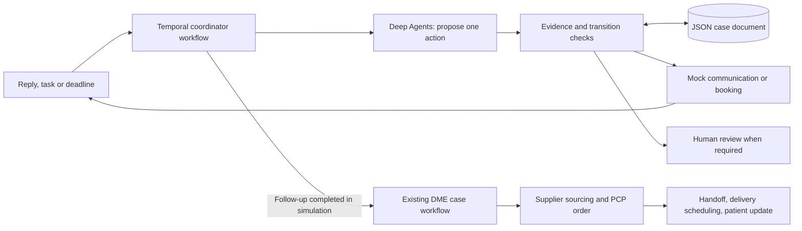

# Automating DME coordination

## What I built and why

The care advocate's hardest job is maintaining progress across unreliable handoffs: a supplier stops answering, an order is wrong, the PCP requests another assessment, or the patient is unsure about the bill. I built a durable case runner first, then added an agent to handle administrative follow-ups that do not fit a fixed sequence.

The original `CaseWorkflow` sources suppliers and chases the PCP order in parallel, validates the returned order, hands it off, follows up with the supplier, falls back when needed, and updates the patient. A separate Deep Agents coordinator manages assessment/report and cost-clarification tasks. It chooses a next action from current evidence; application code validates and records the transition. Temporal owns waiting, retries, signals and execution history. A case resumes after a delayed reply without keeping a model call open.

The integrated simulation makes coordinator completion a prerequisite for the existing DME workflow. This composition is implemented in the simulation parent; automatic takeover of every escalation in the original Cloud case is not yet implemented.

## Technology and architecture

Python and Pydantic define typed boundaries. Deep Agents supplies the LangGraph-based tool loop; its scratchpad is not authoritative state. Groq `openai/gpt-oss-120b` currently handles planning and call extraction; `MODEL_PROVIDER` supports Groq or OpenRouter. JSON case documents serve as a minimal document database, with file locks, atomic replacement, versions, event deduplication and mock action receipts.

The [architecture document](ARCHITECTURE.md) expands the diagram and ownership boundaries. The original demo uses Temporal Cloud. The five integrated simulations used real **local time-skipping Temporal servers**, not Cloud, so their executions do not appear in the Cloud UI. Their histories and timestamped traces were exported independently.

AI extracts observations and proposes administrative actions. Code checks supplier qualification, order consistency, explicit scheduling evidence, exact-slot consent, current-quote acceptance, stale state and task completion. Clinical assessment, prescription changes and medical-necessity decisions remain with qualified people. Passing order checks is not a coverage guarantee.

## Safety, consistency and state

The intended product posture is **safety over liveness and consistency over availability**. If consent, evidence, current state or an external action's outcome is uncertain, keep the task blocked and visible rather than advancing it speculatively. The patient should receive a clear status and a human route; safety must not become silent abandonment.

Business facts and lifecycle belong in the canonical case document; Temporal records orchestration progress. Event IDs and action IDs make redelivery and activity retries deduplicable. Plans are produced outside the write lock and checked against the latest document version before commit. An old quote acceptance does not authorize a new price; an expired slot is not a booking.

These are prototype safeguards, not a production consistency guarantee. JSON locking works on a shared local filesystem, not across independent hosts. Temporal and the document store do not form one transaction, and current receipts describe mocked effects. Before real external actions, persist intent in an outbox, use provider idempotency where available, and reconcile uncertain outcomes before retrying. If authoritative state cannot be read or ownership verified, do not issue a booking or other consequential mutation.

Scale across cases while serializing mutations within a case. A future document store needs conditional writes, a fenced case owner and sufficient read/write consistency. During a partition, pause affected writes instead of accepting divergent decisions. This trades some latency and availability for correct handoffs; it does not require stopping unrelated cases. Cross-case appointment and supplier capacity also need authoritative reservation checks.

## Evidence and cuts

The first live five-scenario evaluation passed **4/5**: a clinical request was misrouted into appointment questions. The integrated Temporal run passed **5/5**, with four delivery schedules and one human handoff, across 37 model requests and zero rate-limit responses. One no-proposal turn recovered through a Temporal retry. **72 automated tests pass.** The earlier failure remains a regression case; a successful rerun does not establish consistent clinical routing.

Phone/voice, fax, booking, external confirmations and human actors remain mocked. Simulation callback evidence is fixture metadata; DME call extraction and coordinator decisions use the real model. The prototype ends at delivery scheduled. Real delivery confirmation, eligibility/portal access, claims, authentication, distributed storage and production deployment are cut. Full evidence and limitations are in [SIMULATION_RESULTS.md](SIMULATION_RESULTS.md).

## Product evolution, in priority order

1. **Coordinator improvements.** Preserve the patient's actual intent, distinguish administrative from clinical requests, reduce repeated questions, and make ownership, deadlines and completion evidence explicit. Add local-time offers, clear booking confirmations and recovery from conflicting or late replies. Keep one accountable coordinator before adding specialist agents.
2. **Policy tuning, business safeguards and online checks.** Encode clinical-review requirements and allowed transitions in state and tools. Bind approvals to exact terms; add outbox dispatch, action reconciliation and contact budgets. Online checks should detect unsupported progress, duplicate actions and unresolved obligations, then pause or route review. A model-based evaluator must not grant permissions or override deterministic guards.
3. **Observability and evaluation.** Build on the existing traces with correlated case/task/event/action IDs, policy and prompt versions, latency, cost and human decisions. Add reviewed datasets, repeated runs, paraphrases, delayed/duplicate events and failure injection. Measure semantic consistency, unsupported advancement, unnecessary escalation, patient effort and actual service completion; aggregate pass rate alone is insufficient.
4. **Model updates.** Compare pinned model/prompt/tool-schema versions on the same gates, then shadow and canary them with rollback. Promote on demonstrated safety and consistent task outcomes before optimizing cost or speed. Do not silently switch to an unvalidated fallback model during an outage.
5. **Voice agent.** Integrate one bounded call type first, with recordings/transcripts, identity and consent handling, call windows and receipts. Separate placing the call from interpreting it so an extraction retry does not redial the patient.
6. **Additional tools and channels.** Add email, asynchronous chat, document/fax exchange, scheduling and authorized payer checks through the same event and action contracts. Correlate replies to the right case, preserve recipient permissions and avoid duplicate outreach across channels. The product should progressively remove administrative work while retaining a useful exception inbox for advocates and clinicians.

**One more day:** address coordinator intent routing and its highest-risk guard gaps, add regression cases, and prepare the integrated scenarios for Cloud visibility with compressed timers. **Two weeks:** extend those guards into persistent dispatch/reconciliation and strengthen evaluation/observability; gate model changes on evidence. Begin a bounded voice integration only after those foundations pass. Additional channels follow the same reliability gate rather than a calendar promise.
